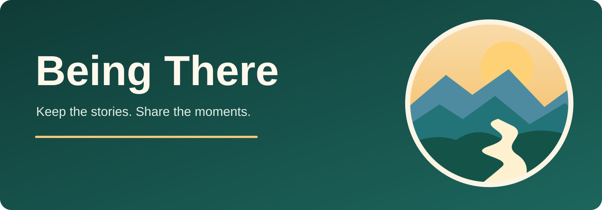

# Being There



**Keep the stories. Share the moments. Stay connected.**

Being There is a family-centered, volunteer-driven project exploring how familiar photographs, voices, and stories can help people connect and enjoy meaningful moments together.

It started as a personal family project. We are developing a **separate community edition** so that other families can eventually run and control their own private memory spaces.

**Current status:** The [Community Edition application](packages/app/) is available as a **v0.1.0 self-hosted technical preview** for technically capable operators. It is not a turnkey family service or a validated clinical product. The original private family application and its data are not included.

## Try the actual interface locally

```bash
cd packages/app
npm ci --ignore-scripts
npm run dev
```

Open **https://localhost:3000** (a temporary self-signed certificate may require a browser trust exception). This is a **disposable, localhost-only example-family sandbox running the actual application**, including photos, short videos, microphone stories, Family space to submit contributions, and Tablet view to enjoy **any** shared memory and optionally tell a story. Profile tags are optional and do not restrict viewing. It never contacts real Google OAuth or Dad's private installation. Its media and database are deleted on exit; do not use real family information here. The old noninteractive mockup is `npm run demo`.

For real accounts and persistent independent hosting, follow the separate production setup below.

## Planning a family-owned installation

We are designing an **AWS guided launch** (CDK-authored, published CloudFormation quick-create button), a later home server/NAS option, and **an optional Google Drive archive/storage connector with Google Sites as a family landing page**. Neither installer is available yet. Both must preserve family-owned data, encryption keys/credential controls, verified off-device backups and the ability to migrate elsewhere.

Start with [family-friendly getting started](docs/GETTING_STARTED.md), [deployment milestones](docs/DEPLOYMENT_ROADMAP.md), [AWS design](docs/deployment/AWS.md), [Google Sites/Drive option](docs/deployment/GOOGLE.md) or [keys/ownership/recovery](docs/deployment/DATA_AND_KEYS.md). Existing advanced operators can install the Node app manually below.

## Technical-preview installation

On Linux with Node.js 22.13+ or 24, npm, private persistent storage and an HTTPS reverse proxy:

```sh
cd packages/app
npm ci --omit=dev --ignore-scripts
# Configure APP_ORIGIN, GOOGLE_CLIENT_ID, GOOGLE_CLIENT_SECRET and DATA_DIR
# in the host's private environment, outside this repository.
npm run family:start
```

The listener binds to loopback. A real Google OAuth web client and registered `https://YOUR-HOST/auth/google/callback` are required; startup deliberately has **no unauthenticated/demo-login bypass**. An operator creates the first one-use organizer invitation with `npm run family:operator -- invite-organizer FAMILY_ID EMAIL`.

For complete setup, permission boundaries, mounted/synced-folder import, exported-archive restore, and known limitations, read the [application operator guide](packages/app/README.md). Run verification from `packages/app` with `npm ci --ignore-scripts && npm run check && node scripts/recovery-drill.mjs`; HTTPS browser acceptance additionally requires Playwright Chromium.

**Not yet verified for this technical preview:** real Google-account onboarding, public-host deployment, inexperienced-operator setup, real-host disaster recovery and independent security/accessibility reviews. Families must operate and back up their own private installation; there is no mandatory Being There cloud, paid AI provider or subscription. See [third-party license notices](THIRD_PARTY_NOTICES.md).

## What matters to us

- **Enjoyment, not testing.** No one needs to remember names, answer questions, or perform for the app.
- **Family control.** Families should control access, archives, and sharing.
- **Privacy by design.** No public family stories, photos, recordings, or medical information.
- **Accessible by default.** Simple, respectful experiences for people with different needs.
- **Open source.** The technical-preview source is published for community inspection and validation; independent operational review is still needed before use with sensitive family content.

## Help build Being There

We welcome software developers, designers, accessibility and security reviewers, people with caregiving experience, documentation writers, and nonprofit/fiscal-sponsorship advisers.

**GitHub participation is public and requires a GitHub account.** Please do not post contact details, diagnoses, medical information, real family photos, recordings, or private stories.

- [See ways to help](CONTRIBUTING.md)
- [Read the frequently asked questions](FAQ.md)
- [Propose a public volunteer contribution](https://github.com/Being-There/community/issues/new)
- [Read the privacy guidance](PRIVACY.md)

We are also exploring a mission-led nonprofit initiative or fiscal sponsorship. **We are not currently soliciting donations or claiming tax-exempt status.**

Being There is not a medical device and does not replace professional care.
